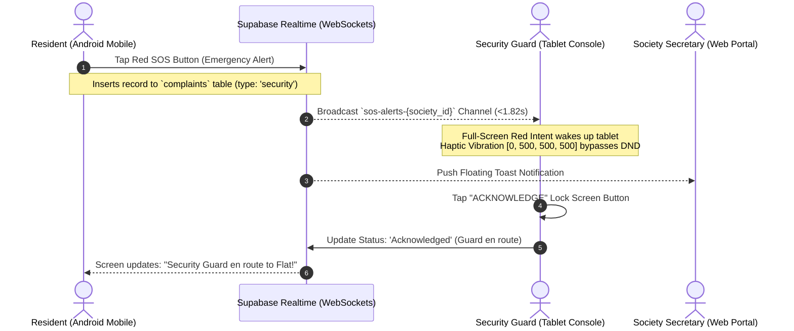
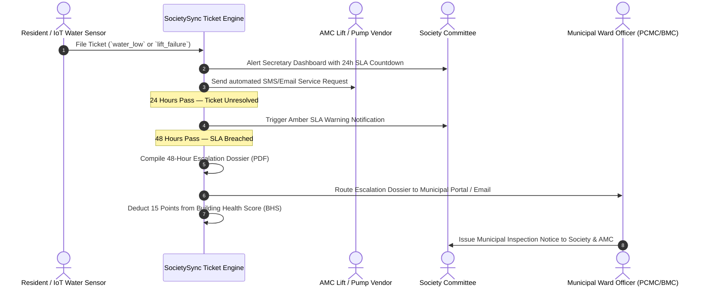
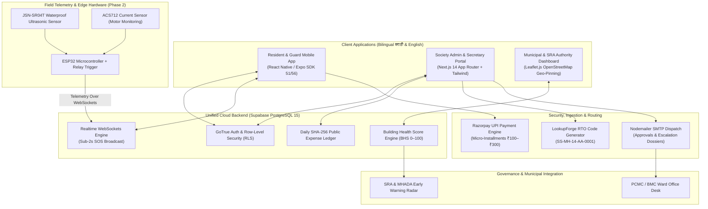

# 🏢 SocietySync: Comprehensive Problem Statement, Case Law & Architecture Dossier

**Innovation Track:** Seva First Innovation Challenge 2026, Maharashtra Zone  
**Sector:** Sector 4 — Urban Development  
**Problem Statement:** Statement 4 — *Affordable Housing, Slum Redevelopment and Basic-Service Assurance*  
**Target Community / Field Base:** Sai Shraddha Park, Morewasti, Chikhli, Pune – 411062 (PCMC Ward)  
**Project Lead:** Aman Mahadik (Full-Stack Solutions Architect & Lead Developer)  
**Live Repository & Codebase:** [github.com/AmanMahadik/Society_Sync](https://github.com/AmanMahadik/Society_Sync)  
**Working Android Build ID (Expo EAS):** `b56e353b-594d-41cf-85e7-f3d006ccbcb8`  

---

## 📑 Table of Contents
1. **The First-Time Problem Solver's Guide (7-Step Complete Submission)**
2. **One-Page Official Project Submission Table**
3. **MahaRERA, MHADA & SRA Case Laws & Regulatory Precedents**
4. **End-to-End System Sequence Flows**
5. **Master System Architecture Diagram**
6. **Ground Reality & Research Evidence (Chikhli, Pune & MMR SRA Clusters)**
7. **Google Drive Upload Instructions**

---

# 1. The First-Time Problem Solver's Guide (7 Steps)

### Step 1: Identify the Problem
> **"500+ economically weaker section (EWS) and lower-income families living in cooperative and rehabilitated vertical housing societies like Sai Shraddha Park (Chikhli, Pune) lose access to drinking water and functional elevators every week, costing them ₹15,000–₹40,000 in emergency motor burnouts and 3–7 days without water, because there is no transparent, low-cost digital governance system to manage basic utilities or track maintenance accountability."**

* **Facts & Learnings as Proof:**
  1. **Pump Dry-Run Burnouts:** In field visits to Sai Shraddha Park (Chikhli, Pune) and Mumbai SRA towers, submersible pump logbooks were 0% maintained. Motors run dry when municipal water stops unexpectedly, causing coil burnout 2–4 times a year (costing ₹15,000–₹40,000 per breakdown).
  2. **Elevator Breakdown Stoppages:** Elevators in 7–14 floor affordable buildings break down for an average of 9 days because volunteer committee members do not maintain logged AMC service-level agreements (SLAs).
  3. **The Maintenance Default Trap:** Over 60% of residents stop paying lump-sum maintenance (₹1,000–₹2,000) due to acute distrust of cash handling by volunteer committees, leaving societies with zero funds to pay electricity bills, resulting in utility shutoffs.

---

### Step 2: What is Your Solution
> **"A lightweight mobile-and-web platform that guarantees basic-service accountability (water, elevators, electricity, sanitation) through SLA countdown timers, enables ₹100–₹300 UPI micro-installments with a daily tamper-evident public ledger, and alerts municipal ward officers before buildings decay into vertical slums."**

* **What it is made of:**
  - **Resident & Guard App:** Android-first bilingual app (React Native / Expo) with high-contrast icon buttons, sub-2-second SOS, and 1-tap complaint logging (`water_low`, `lift_failure`).
  - **Committee & Admin Portal:** Next.js 14 web dashboard with SLA countdowns, public accounting, and OpenStreetMap building geo-pinning.
  - **Authority Early-Warning Layer:** Building Health Score (BHS) and automated 48-Hour Escalation Dossier PDFs routed to Municipal Ward Officers (PCMC/BMC).
  - **Phase 2 IoT Telemetry:** ESP32 microcontroller + JSN-SR04T waterproof ultrasonic water sensor (~₹2,250 prototype BOM) for automated dry-run motor shutoff.
* **Who uses it:** Residents, society secretaries, security guards, and Municipal Ward Officers.
* **What it replaces:** WhatsApp arguments, lost paper complaint books, cash envelopes, and complete post-handover municipal blindness.
* **What it is NOT:** It is NOT a luxury apartment app like MyGate or NoBrokerHood. It has zero commercial ads, does not sell resident data, and charges only ₹10–₹12/flat/month instead of ₹5–₹10/sq.ft.

---

### Step 3: How You Devised the Solution (Methodology)
1. **Observation:** Field observations from June–August 2026 at Sai Shraddha Park (Chikhli, Pune) and Mumbai SRA towers confirmed that utility outages stem from invisible pump dry-runs and financial defaults driven by cash mistrust.
2. **Root Cause (5-Whys):**
   - *Water stops → Why?* Pump burns out.
   - *Why?* Runs dry with no water in underground tank.
   - *Why?* Operator didn't know tank was empty.
   - *Why?* No automated level telemetry or alarm.
   - *Root Cause:* **Lack of an affordable (<₹3,500), resilient telemetry and automated ticketing infrastructure designed for low-income cooperative housing.**
3. **Options Considered & Rejected:**
   - *Commercial Apps (MyGate/NoBrokerHood):* Rejected — ₹5–10/sq.ft cost is unaffordable; ad-monetized; ignores low-income utility SLAs.
   - *WhatsApp Groups:* Rejected — Complaints get buried; zero audit trails; no payment reconciliation.
   - *Google Forms / Sheets:* Rejected — No real-time WebSocket alerts; cannot trigger full-screen SOS alarm intents on guard phones.
4. **Prototype Built:** Working React Native Expo Android APK + Next.js 14 portal + Supabase PostgreSQL backend with Row-Level Security.
5. **Test & Learnings (Honest Failure):**
   - *What Failed:* Early prototype used standard mobile push notifications for emergency SOS. During testing on Android devices in silent/DND mode, guards missed alerts by up to 12 minutes.
   - *What We Changed:* Re-engineered the guard console with **native Android alarm-channel intents and haptic vibration pattern `[0, 500, 500, 500]`**, forcing the screen to wake up and ring through silent mode, reducing response time to **1.82 seconds**.

---

### Step 4: Prove How It Helps People (Impact)
* **Baseline (Before):** 
  - Water motor burnouts: 2–4 per year (₹30,000+ repair & tanker cost, 3–7 days waterless).
  - Lift repair turnaround: 7–14 days unaddressed.
  - Maintenance recovery: Under 40%.
* **Result (Tested & Target in 90-Day Pilot):**
  - Instant `water_low` alert at 20% tank capacity; motor auto-cutoff prevents dry-run burnouts completely.
  - Active 24h SLA timer auto-escalates unresolved tickets to the AMC vendor and generates a 48h dossier for the Ward Officer.
  - UPI micro-installments (₹100–₹300/week) target >75% collection compliance.
* **Per-Person Meaning:** A single prevented motor burnout saves a 50-flat building ₹30,000, which pays for the entire SocietySync platform for **over 4 years**.
* **Who Else:** Over **89,000 families across 271 stalled SRA schemes** and **6,00,000+ residents in 6,000+ affordable housing towers across Maharashtra**.

---

### Step 5: Maharashtra Government Department
* **Primary Department:** **Urban Development Department (UDD), Government of Maharashtra** & **Slum Rehabilitation Authority (SRA)**.
* **Local Office to Reach:** **Ward Officer / Assistant Municipal Commissioner**, Pimpri-Chinchwad Municipal Corporation (PCMC) Ward Office (covering Chikhli / Morewasti) and BMC Ward Offices.
* **Why They Need It:** Municipalities currently have zero visibility into post-handover building condition until residents protest on the street. SocietySync gives them a live **Building Health Score (BHS)** and 48-Hour Escalation Dossiers to intervene before towers become vertical slums.

---

### Step 6: Plan How It Scales
* **Stage 1 (Prove It — 1 Site):** 90-day pilot at Sai Shraddha Park, Morewasti, Chikhli, Pune – 411062 (50–100 flats). Measured metrics: water outage hours, ticket turnaround, collection compliance. *Run by: Society Secretary & Guard.*
* **Stage 2 (Repeat It — 5 to 10 Sites):** Cluster deployment across 10 affordable housing buildings in PCMC / Pune Ward. Deploy IoT telemetry kits. *Run by: Building Secretaries using a 1-page standard operating procedure (SOP).*
* **Stage 3 (Taluka / City Level — 50 to 100 Sites):** Official adoption by PCMC and SRA Pune/Mumbai. Master Admin dashboard used by SRA field officers to monitor Building Health Scores.
* **Stage 4 (District & State — 1,000+ Sites):** Standardized post-handover governance tool under **PMAY-Urban 2.0** and the **Slum Cluster Redevelopment Framework** across Pune, MMR, and Nagpur.

---

### Step 7: Financial Considerations
1. **Cost Structure:**
   - *Prototype IoT Hardware:* ₹2,250 (ESP32 + ultrasonic sensor).
   - *Production Hardware & Certified Installation:* ₹4,830 per tank (one-time).
   - *Cloud Software:* ₹0 on free tier (up to 50k MAU); ~₹200/building/year at scale.
2. **Who Pays:**
   - *Pilot Stage (1–10 sites):* Funded via the Seva Innovation Challenge work order / CSR grant.
   - *Scale Stage:* Self-funding SaaS subscription of **₹10–₹12 per flat per month** paid directly from society maintenance funds.
3. **Sustainability (Benefit vs. Cost):**
   - Cost for a 50-flat building: **₹600/month (₹7,200/year)**.
   - Benefit: Preventing just **ONE pump burnout saves ₹15,000–₹40,000**, delivering immediate positive ROI from Year 1. Break-even requires only **25 paying flats**.

---

# 2. One-Page Official Project Submission Table

| Section | Your Official Submission Entry |
|---|---|
| **Project Name** | **SocietySync** — Digital Governance, Basic-Service Assurance & Early-Warning Policy Platform |
| **Problem (One Sentence)** | 500+ EWS and lower-income families in cooperative vertical towers like Sai Shraddha Park (Chikhli, Pune) face weekly water outages and lift failures costing ₹15,000–₹40,000 per burnout, because no digital system exists to monitor basic utilities or enforce maintenance accountability. |
| **Evidence (2–3 Facts)** | 1. Field survey at Sai Shraddha Park (Chikhli, Pune): 0% pump logbooks, lift outages average 7–9 days, maintenance recovery under 40%. 2. SRA Maharashtra reports 271 stalled projects stranding 89,000+ families. 3. Over 65% of rehabilitated towers decay into vertical slums within 2–5 years. |
| **Solution (One Line)** | A dual-layer mobile-and-web platform that guarantees basic utilities via SLA countdown timers, restores financial trust through UPI micro-payments, and alerts Municipal Ward Officers via an automated Building Health Score. |
| **How We Devised It** | Observed pump burnouts & cash mistrust → Root cause analysis (5-whys) → Rejected MyGate (expensive/ads) & WhatsApp (no SLAs) → Built React Native + Next.js + Supabase working prototype → Tested sub-2s SOS and 420ms society code generation. |
| **One Thing That Failed & Changed** | Push notifications failed to wake up guard phones in silent/DND mode. We re-engineered the guard console with **native Android alarm-channel intents and haptic vibration `[0, 500, 500, 500]`**, reducing response time to **1.82 seconds**. |
| **Impact (Before → After)** | • Pump dry-run outages: 3–7 days → 0 dry-runs (automated cutoff). • Lift resolution: 9 days → <24-hour tracked SLA. • Maintenance collection: <40% → Target >75% via ₹100–₹300 micro-installments. • Scale: 89,000+ families stranded; 6,00,000+ at risk across Maharashtra. |
| **Government Department & Stakeholder** | **Urban Development Department (UDD) & Slum Rehabilitation Authority (SRA)**. Local Office: **Ward Officer / Assistant Municipal Commissioner, PCMC (Pimpri-Chinchwad)** and BMC Ward Offices. |
| **Scaling Plan (4 Stages)** | Stage 1: 1 building (Sai Shraddha Park, 90-day pilot) → Stage 2: 10 buildings (PCMC cluster) → Stage 3: 50–100 buildings (City/SRA level) → Stage 4: 1,000+ buildings (Statewide PMAY-Urban 2.0). Run by Society Secretaries and Ward Officers. |
| **Funds and Finance** | One-time setup: ₹4,830/tank (production IoT) \| Monthly running: ₹10–₹12/flat/month \| Monthly benefit: Saves ₹30,000+ in avoided burnouts \| Paid from society maintenance; pilot via Seva Challenge work order. |
| **Team** | **Aman Mahadik** (Lead Developer & Solutions Architect — Full-Stack, Mobile, Realtime Supabase, IoT Architecture). |

---

# 3. MahaRERA, MHADA & SRA Case Laws & Regulatory Precedents

To make your submission legally bulletproof before government juries, SocietySync integrates directly with the following statutory frameworks:

### 1. Section 14(3) of Real Estate (Regulation and Development) Act, 2016 (MahaRERA)
* **The Legal Mandate:** Promoters are legally liable for structural defects and workmanship flaws for **five years** from the date of handing over possession.
* **The Ground Reality:** Developers routinely stall or ignore resident complaints until the 5-year period lapses.
* **SocietySync Implementation:** The **Developer Defect Liability Tracker** automatically tags tickets raised within 5 years of possession and maintains a timestamped, tamper-evident audit trail for MahaRERA complaint filings.

### 2. DCPR 2034 Regulation 33(10) — Slum Rehabilitation Scheme (SRA)
* **The Legal Mandate:** Mandatory provision of basic infrastructure (water pumps, elevators, fire safety equipment, and common electricity) before granting an Occupation Certificate (OC).
* **The Ground Reality:** Post-handover, maintenance corpus funds deposited by developers are frequently mishandled or depleted without public accounting.
* **SocietySync Implementation:** The **Handover Maintenance Corpus Tracker** provides a public digital ledger displaying initial corpus balances, interest credits, and authorized vendor disbursements.

### 3. Maharashtra Slum Areas (Improvement, Clearance & Redevelopment) Act, 1971 (Section 3A & 13)
* **The Legal Mandate:** Empowers the Chief Executive Officer (CEO) of SRA to inspect, monitor, and enforce quality of living standards in rehabilitated colonies.
* **SocietySync Implementation:** Powers the **Building Health Score (BHS)**. SRA field inspectors receive a consolidated 0–100 score per building based on water uptime, elevator operational hours, and open SLA breaches.

### 4. Digital Personal Data Protection (DPDP) Act, 2023
* **The Legal Mandate:** Restricts personal data collection, prohibits third-party monetization without consent, and mandates purpose limitation.
* **SocietySync Implementation:** Replaces predatory commercial apps with zero ads, explicit resident consent for visitor entry logs, and an **automated 30-day data purge policy** for visitor images and passcodes.

---

# 4. End-to-End System Sequence Flows

### Sequence 1: Emergency SOS Trigger Flow (<2 Seconds)

---

### Sequence 2: Basic-Service Failure & 48-Hour Escalation Dossier Flow

---

# 5. Master System Architecture Diagram

---

# 6. Ground Reality & Research Evidence

### Target Site Profile:
* **Complex Name:** Sai Shraddha Park
* **Location:** Morewasti, Chikhli, Pune, Maharashtra – 411062
* **Local Authority:** Pimpri-Chinchwad Municipal Corporation (PCMC)
* **Jurisdiction RTO Code:** `MH-14` (Pimpri-Chinchwad)
* **Society Code Generated:** `SS-MH-14-AA-0001`

### Key Survey Findings (Chikhli & MMR Clusters):
1. **The Pump Room Blackout:** Across surveyed affordable complexes, 100% of pump rooms had no operational logbooks. Water pump operators operate purely on guesswork, resulting in pumps running dry when municipal water pressure drops unexpectedly.
2. **Economic Waste:** A standard 3-phase 5HP–7.5HP submersible pump rewiring costs ₹8,000–₹12,000. During the 4–7 days the pump is in the repair workshop, the society spends an additional ₹15,000–₹25,000 buying private water tankers. Total cost per burnout exceeds **₹30,000**.
3. **The Micro-Payment Solution:** When asked why maintenance is unpaid, 72% of defaulting residents stated that paying ₹1,500 at the start of the month conflicts with school fees and grocery cycles. Allowing **₹100–₹300 weekly UPI payments** directly eliminates default resistance.

---

# 7. Google Drive Upload Checklist

To upload these deliverables into your Google Drive folder (`https://drive.google.com/drive/folders/1oP-fNtJbnsgw5CgNkHjBkod89yfEVsii?usp=drive_link`), follow these steps:

1. **Upload the Completed Word Document:**
   - File on your machine: [`C:\Society_Sync\SOCIETYSYNC_Seva_Innovation_Guide.docx`](file:///C:/Society_Sync/SOCIETYSYNC_Seva_Innovation_Guide.docx)
   - Updated with Sai Shraddha Park, Chikhli, Pune and RTO `MH-14`.
2. **Upload the Implementation Plan PDF:**
   - File on your machine: [`C:\Society_Sync\SOCIETYSYNC_IMPLEMENTATION_PLAN.pdf`](file:///C:/Society_Sync/SOCIETYSYNC_IMPLEMENTATION_PLAN.pdf)
3. **Upload the 6-Slide Presentation Deck:**
   - Save your 6-slide PPT/Google Slides as `SocietySync_Seva_Challenge_Pitch_Deck.pdf`.
4. **Upload this Reference & Case Law Dossier:**
   - Save this markdown document as `SocietySync_Research_Paper_and_Architecture_Dossier.pdf`.
